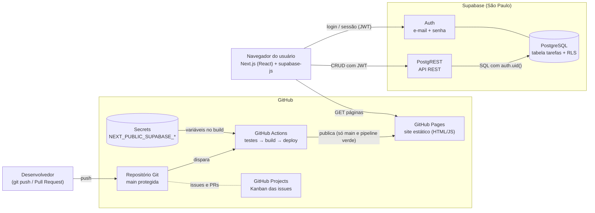

# Arquitetura



## Como as peças conversam

1. **Desenvolvimento:** cada mudança vai para uma branch, que vira Pull Request para a `main`.
2. **Pipeline (GitHub Actions):** a cada push ou PR roda `testes` (lint, tipos, testes com cobertura) e `build`. Na `main`, se tudo passou, roda `deploy`.
3. **Publicação (GitHub Pages):** o `next build` com `output: "export"` gera HTML/JS estático na pasta `out/`. A URL e a chave pública do Supabase entram no build pelos *Secrets* do GitHub.
4. **Execução (navegador):** a página carrega o React. O `supabase-js` autentica no **Supabase Auth**, que devolve um JWT, e chama a **API REST** com esse token.
5. **Segurança dos dados:** o PostgreSQL aplica **Row Level Security**. As políticas usam `auth.uid()` do JWT, então cada pessoa só lê e altera as próprias linhas, mesmo que alguém chame a API diretamente.

## Camadas do código

```
src/app/            rotas (finas): só compõem componentes
src/features/auth/  login, cadastro, sessão, proteção de rota
src/features/tarefas/ CRUD, regras puras (ordenar, resumir), repositório Supabase
src/lib/            ambiente (zod), cliente Supabase, erros, constantes, CSP
src/components/     layout e UI compartilhada
src/i18n/           textos pt-BR
src/theme/          cores, tipografia, medidas, tema MUI
supabase/migrations/ esquema versionado do banco
tests/              unitários, integração e autenticação
```
