

# Projeto Integrador: app web no ar com GCS, testes e DevOps

## Minhas Tarefas — lista de tarefas pessoal com login

**Integrante:** Guilherme Santos de Azevedo (trabalho individual)

**Disciplina:** Gerência de Configuração de Software

**Professor:** Juan Carlos Justinia

**Turma:** 8º período

**Data:** 16/11/2026 · **Versão entregue:** v1.2.0 (linha de base LB-3)

## Links da entrega

| Item | Link |
|---|---|
| **App no ar** | https://guizeroum.github.io/gcs-lista-de-tarefas/ |
| **Repositório** | https://github.com/GuiZeroUm/gcs-lista-de-tarefas |
| **Kanban das issues** | https://github.com/users/GuiZeroUm/projects/1 |
| **Pipeline CI/CD** | https://github.com/GuiZeroUm/gcs-lista-de-tarefas/actions |
| **Versões (releases)** | https://github.com/GuiZeroUm/gcs-lista-de-tarefas/releases |
| **Vídeo final** | _(inserir o link após a gravação; roteiro na seção 11)_ |

> **Como testar:** abra o app, clique em **Criar conta**, informe qualquer e-mail e uma senha com 8+ caracteres, letras e números. Não é preciso confirmar o e-mail.

## Sumário

1. Visão geral e arquitetura
2. Fase 1 — Plano de Gerência de Configuração
3. Fase 2 — Aplicação com login (Supabase)
4. Fase 3 — Controle de versões
5. Fase 4 — Controle de mudanças (RFC, CCB e Kanban)
6. Fase 5 — Testes automatizados
7. Fase 6 — DevOps: pipeline, deploy e segredos
8. Rastreabilidade de ponta a ponta
9. Auditoria final (FCA e PCA)
10. Conclusão: teoria × prática
11. Roteiro do vídeo final

---

## 1. Visão geral e arquitetura

**Minhas Tarefas** é uma lista de tarefas pessoal. A pessoa cria uma conta, entra e gerencia as **próprias** tarefas: título, descrição, prioridade, prazo e situação. Ninguém vê as tarefas de outra pessoa.

| Camada | Tecnologia |
|---|---|
| Interface | Next.js 16 (exportação estática) + React 19 + MUI + Tailwind |
| Banco e login | Supabase (PostgreSQL + Auth), região São Paulo |
| Testes | Vitest + Testing Library, cobertura v8 |
| Repositório, CI/CD, Kanban | GitHub, GitHub Actions, GitHub Projects |
| Hospedagem | GitHub Pages |

**Decisão de plataforma (CCB, decisão D-00).** O enunciado sugere GitLab, GitLab CI e Vercel. A pedido do aluno, usamos os equivalentes do GitHub, com o mapeamento registrado no PGC: *Merge Request* = *Pull Request*; `.gitlab-ci.yml` = `.github/workflows/ci-cd.yml`; *Issue Board* = *GitHub Projects*; deploy do Vercel = deploy pelo próprio pipeline no GitHub Pages. O CCB aprovou a troca **com condições**: merge bloqueado por pipeline vermelho, deploy automático e nenhuma chave no repositório. As três foram cumpridas (seções 4 e 7).

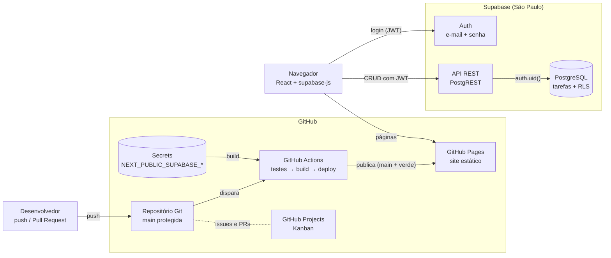

O site é estático: o navegador fala direto com o Supabase. A segurança dos dados fica no banco, com **Row Level Security** (cada política compara `auth.uid()` com o dono da linha). Assim, mesmo quem chamar a API por fora só alcança as próprias tarefas.

---

## 2. Fase 1 — Plano de Gerência de Configuração

**Entregável:** [`PGC.md`](https://github.com/GuiZeroUm/gcs-lista-de-tarefas/blob/main/PGC.md), aprovado na linha de base **LB-0 (`v0.1.0`)**.

**Itens de configuração (resumo):**

| ID | Item | Local |
|---|---|---|
| IC-01 | Código-fonte | `src/` |
| IC-02 | Testes | `tests/` |
| IC-03 | Migrações do banco | `supabase/migrations/` (migração aplicada nunca é editada) |
| IC-04 | Build e dependências | `package.json`, `bun.lock`, configs |
| IC-05 | Pipeline | `.github/workflows/ci-cd.yml` |
| IC-06 | Modelo de ambiente | `.env.example` |
| IC-07/08 | Documentação de GCS e técnica | PGC, ATA_CCB, CHANGELOG, README, DEPLOY, `docs/` |
| IC-09 | Modelos de processo | modelos de RFC, tarefa e PR |

**Papéis.** Por ser individual, Guilherme acumula os papéis de gerente de configuração, desenvolvedor, revisor e CCB (presidente e único membro votante; o professor é parte interessada consultiva). Cada papel tem momento e registro próprios. A revisão automática **obrigatória** é o pipeline, que bloqueia o merge.

**Versionamento semântico.** MAJOR para quebra de compatibilidade; MINOR para funcionalidade nova compatível; PATCH para correção. A tag anotada `vX.Y.Z` é criada só na `main`, com o pipeline verde, e vira uma *Release*.

**Branches.** `main` protegida (só via PR com `testes` e `build` verdes); branches `tipo/<issue>-resumo`; Conventional Commits; merge commit; branch apagada após o merge.

**Linhas de base:** LB-0 `v0.1.0` (planejamento) → LB-1 `v1.0.0` (funcional) → LB-2 `v1.1.0` (RFC-01) → LB-3 `v1.2.0` (RFC-02, entrega).

---

## 3. Fase 2 — Aplicação com login (Supabase)

| Requisito | Como foi atendido |
|---|---|
| Login com Supabase Auth | E-mail e senha (cadastro, login, logout) em `src/features/auth/services/autenticacao.ts` |
| Área protegida | `/tarefas/` envolvida por `ProtecaoDeRota`: sem sessão, a pessoa é levada para `/entrar/` |
| CRUD no PostgreSQL | Criar, listar, editar (diálogo), concluir e excluir (com confirmação) em `src/features/tarefas/` |
| Esquema versionado | `supabase/migrations/20261116150000_criar_tabela_tarefas.sql` e `20261116170000_adicionar_prazo_das_tarefas.sql` |

**Decisões:**

- **Row Level Security** com quatro políticas (select, insert, update, delete), todas `auth.uid() = usuario_id`. A coluna `usuario_id` tem `default auth.uid()`, então o app nem envia o dono, e o banco recusa forjar outro.
- **Validação nas duas pontas:** zod no formulário (título 1–120, descrição até 1000, prazo como data válida) e `check` no banco.
- **Senha:** mínimo de 8 caracteres com letras e números, no app e na configuração do Supabase Auth.
- **Confirmação de e-mail desligada:** o SMTP grátis do Supabase só envia e-mail para membros da equipe; sem isso, o professor não conseguiria se cadastrar.

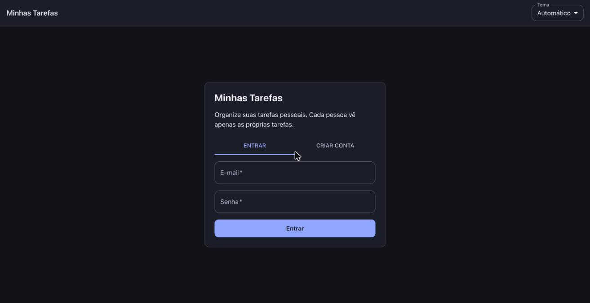

---

## 4. Fase 3 — Controle de versões

| Critério | Evidência |
|---|---|
| Repositório com acesso público | https://github.com/GuiZeroUm/gcs-lista-de-tarefas |
| Commits frequentes e claros | Mais de 20 commits em Conventional Commits, cada um dizendo **por que**, **o que** e **como foi verificado** |
| `.gitignore` adequado | Ignora `.env*` (exceto `.env.example`), `node_modules`, `.next`, `out`, `coverage` |
| Duas ou mais branches com merge | 5 branches integradas por Pull Request (#3, #4, #10, #11, #12) |
| Duas ou mais tags | `v0.1.0`, `v1.0.0`, `v1.1.0`, `v1.2.0`, todas com Release |
| README com instruções | `README.md`: o que é, stack, como rodar, como testar, link no ar |

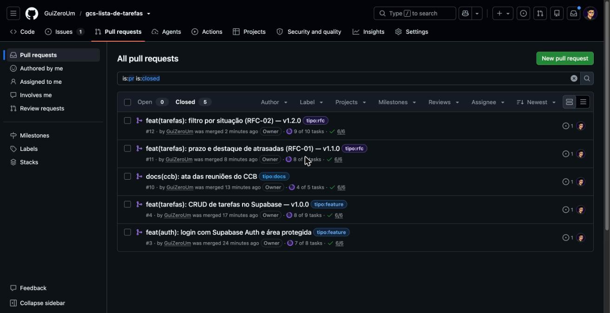

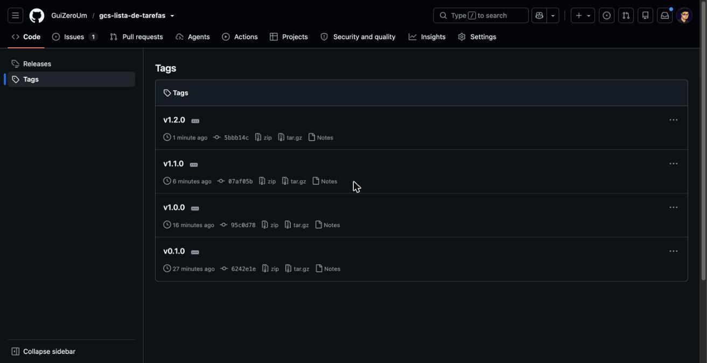

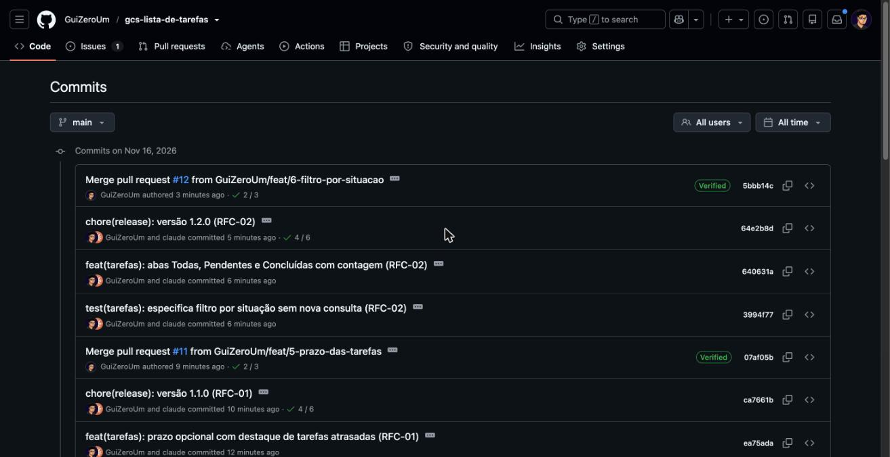

---

## 5. Fase 4 — Controle de mudanças (RFC, CCB e Kanban)

**Solicitações de mudança (issues do tipo RFC)**, abertas pelo modelo `.github/ISSUE_TEMPLATE/rfc.md`, cada uma com descrição, justificativa, prioridade, análise de impacto por item de configuração, versão resultante e critérios de aceite:

| RFC | Issue | Prioridade | Impacto | Decisão do CCB | Resultado |
|---|---|---|---|---|---|
| RFC-01 Prazo das tarefas | #5 | Alta | Nova coluna (aditiva), MINOR | **Aprovada** | PR #11 → `v1.1.0` |
| RFC-02 Filtro por situação | #6 | Média | Só cliente, MINOR | **Condicionada** (sem nova consulta ao banco; cobertura ≥ 85%; depois da RFC-01) | PR #12 → `v1.2.0` |
| RFC-03 Exportar CSV | #7 | Baixa | Risco de *CSV injection* | **Adiada** | Backlog |
| RFC-04 Compartilhar tarefas | #8 | Média | Reescreve o RLS, MAJOR | **Rejeitada** | Issue fechada como "não planejada" |

**Ata do CCB:** [`ATA_CCB.md`](https://github.com/GuiZeroUm/gcs-lista-de-tarefas/blob/main/ATA_CCB.md). Registra a reunião 1 (decisão D-00 de plataforma) e a reunião 2 (RFC-01 a RFC-04), com justificativas, condições e acompanhamento. Cada RFC recebeu o rótulo `ccb:*` e um comentário com a decisão.

**Implementação das aprovadas:** cada uma em sua branch (`feat/5-prazo-das-tarefas`, `feat/6-filtro-por-situacao`) e PR com `Closes #n`. O merge fechou a issue, gerou nova versão, tag, Release e deploy. As condições da RFC-02 foram **verificadas por teste automatizado** (o número de consultas ao Supabase não muda ao trocar de aba) e pela cobertura de 98%.

**Kanban (GitHub Projects, público):** colunas **Backlog → A fazer → Fazendo → Em revisão → Concluído**, cards com rótulos de tipo, prioridade e decisão do CCB, responsável e PR ligado. Automações: issue nova entra sozinha em *Backlog*; PR ligado move para *Em revisão*; merge ou fechamento move para *Concluído*.

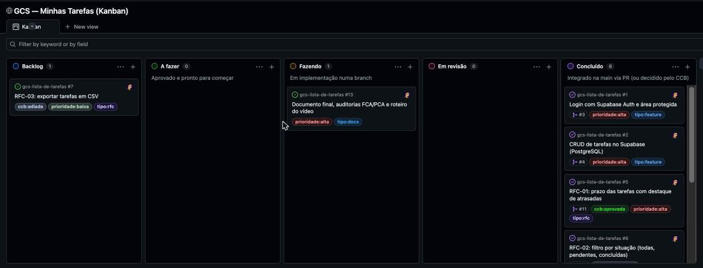

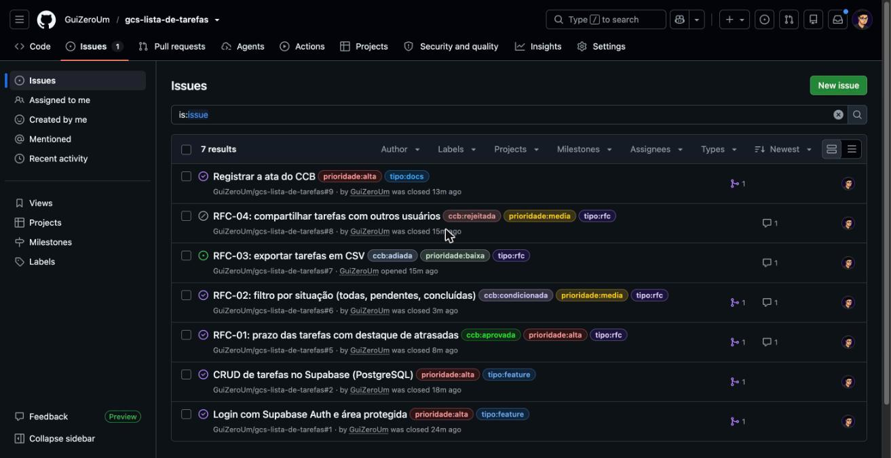

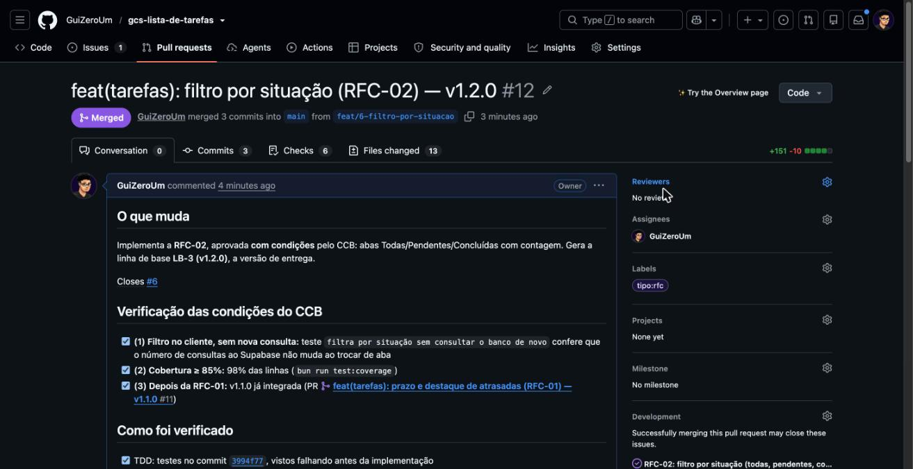

---

## 6. Fase 5 — Testes automatizados

**87 testes em 16 arquivos, todos passando** localmente e no pipeline. Os testes não dependem do Supabase real: `tests/support/supabaseFalso.ts` é um **Supabase simulado em memória** que imita a API do `supabase-js` e o **Row Level Security**.

| Tipo | Arquivos | Testes | O que cobre |
|---|---|---|---|
| Unitários (regras e validações) | `tests/unit/**` (11 arquivos) | 48 | Validação de tarefa e de login/cadastro, ordenação, resumo, atraso, filtro, datas, ambiente, erros, layout |
| Integração do CRUD | `tests/integration/tarefas/*` (2 arquivos) | 22 | Repositório e tela: criar, listar, editar, concluir, excluir, cancelar exclusão, prazo, filtros, falha do banco, **isolamento entre usuários** |
| Autenticação | `tests/auth/*` (3 arquivos) | 17 | Bloqueio sem login, liberação após login, saída, login certo/errado, cadastro, senha fraca, e-mail repetido |

**Cobertura (v8):** linhas **98%** · comandos 97,5% · funções 99% · ramos 92%. O pipeline **falha** abaixo de 85% de linhas (`vitest.config.mts`).

**Qualidade dos testes (além da cobertura):**

- **TDD nas RFCs:** os testes de cada RFC foram commitados **antes** da implementação e vistos falhando pelo motivo esperado (commits `b2b1d11` e `3994f77`).
- **Mutação manual:** seis defeitos foram introduzidos de propósito (guarda liberada, ordem invertida, `delete` sem filtro, tela que não atualiza, senha sem número, descrição vazia). Um sobreviveu, o `delete` sem filtro, que apagaria todas as tarefas do usuário. Por isso foi criado o teste "excluir uma tarefa mantém as demais", que matou o mutante.

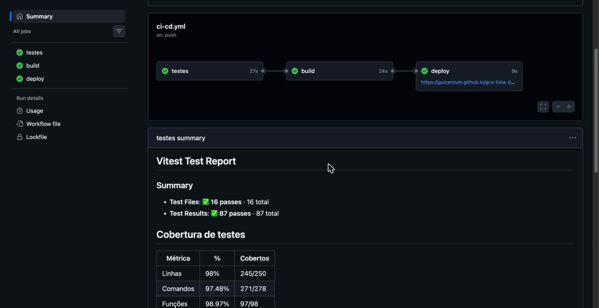

O relatório HTML completo fica como **artefato** `relatorio-de-cobertura` em cada execução do pipeline.

---

## 7. Fase 6 — DevOps: pipeline, deploy e segredos

**Pipeline (`.github/workflows/ci-cd.yml`)**, disparado em todo push e em todo PR para a `main`:

| Job | O que faz |
|---|---|
| `testes` | `bun install --frozen-lockfile` → lint → checagem de tipos → testes com cobertura → resumo na página do pipeline → artefato de cobertura |
| `build` | Confere os Secrets → `next build` com `BASE_PATH` → empacota o site (na `main`) |
| `deploy` | Só na `main`: publica no GitHub Pages (ambiente `github-pages`) |

**Pipeline vermelho não vai para produção:** `deploy` depende de `build`, que depende de `testes`. A proteção da `main` exige PR e os status `testes` e `build` verdes, com a branch atualizada, e vale **também para o administrador**.

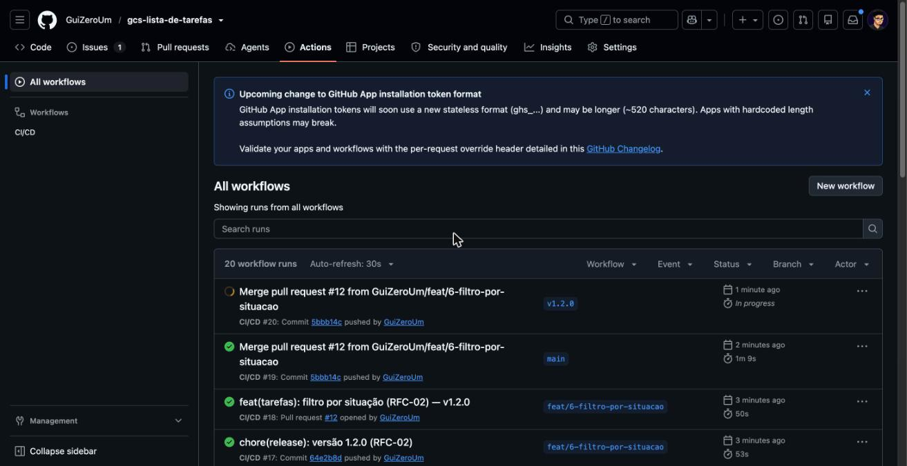

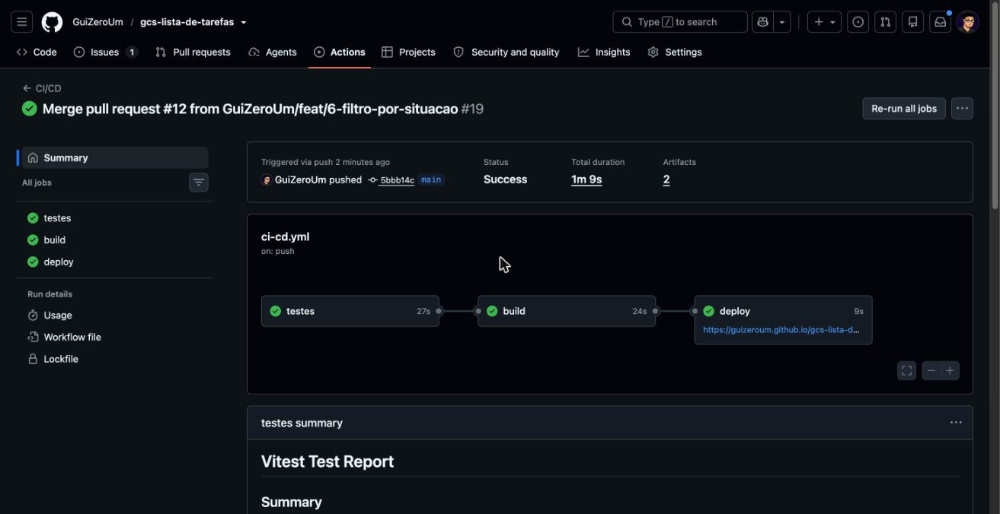

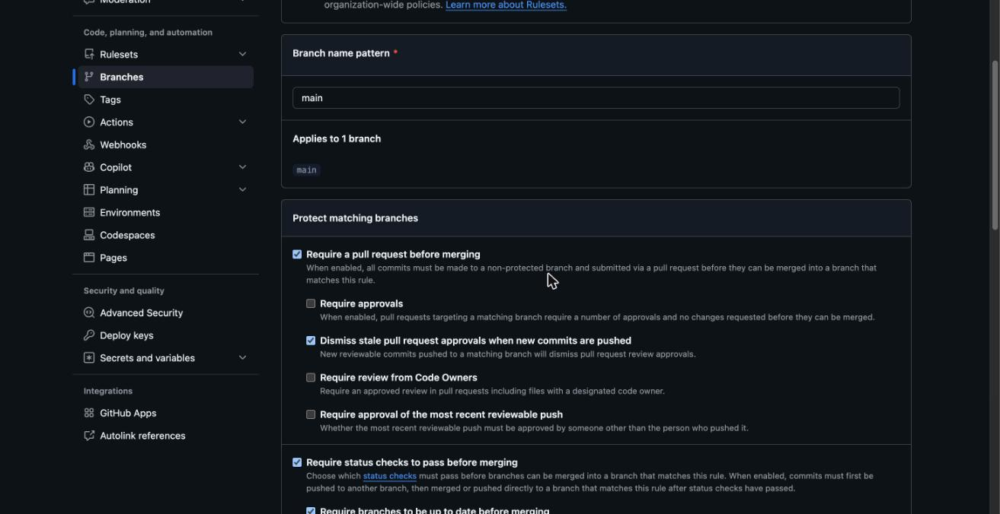

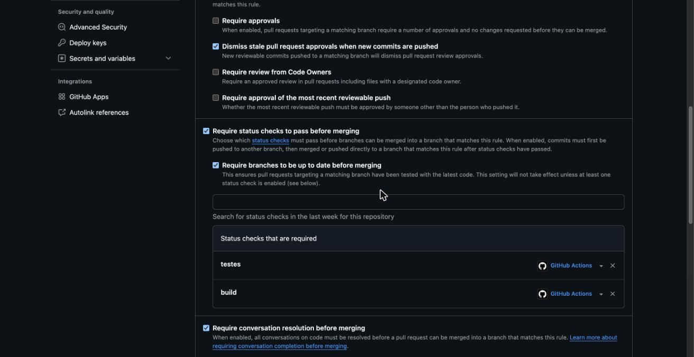

**Segredos:** a URL e a chave **pública** (publishable/anon) do Supabase ficam nos *Secrets* do GitHub Actions e, localmente, em `.env.local` (ignorado). O repositório tem só o `.env.example`, sem valores. A chave secreta (`service_role`) não é usada em lugar nenhum. A varredura de todo o histórico (`git grep` em todas as revisões) não encontrou nenhuma chave real.

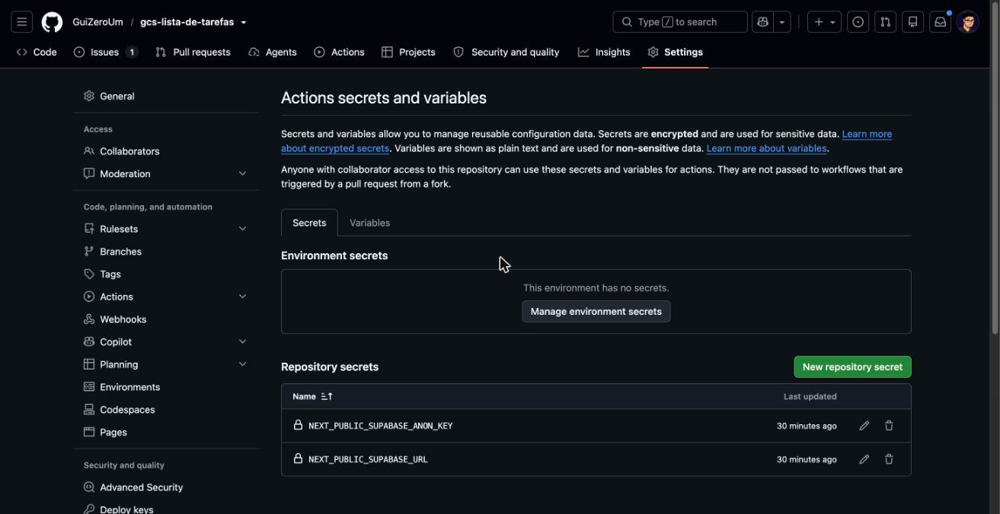

**Reprodutibilidade:** o [`DEPLOY.md`](https://github.com/GuiZeroUm/gcs-lista-de-tarefas/blob/main/DEPLOY.md) descreve, do zero, a criação do projeto Supabase, as migrações, a configuração do Auth, as chaves, os Secrets, o GitHub Pages, a proteção da `main`, o funcionamento do pipeline, a publicação de versões e os problemas comuns.

---

## 8. Rastreabilidade de ponta a ponta

| Mudança | Issue | Branch | Commits principais | PR | Versão | Deploy |
|---|---|---|---|---|---|---|
| Login | #1 | `feat/1-autenticacao` | `31a7a97`, `3ab14fe`, `0f09ae1` | #3 | v1.0.0 | ✔ |
| CRUD | #2 | `feat/2-crud-de-tarefas` | `54f9b9b`, `ebf238d`, `182a7a3`, `abab484` | #4 | v1.0.0 (`95c0d78`) | ✔ |
| Ata do CCB | #9 | `docs/9-ata-ccb` | `2412687` | #10 | — (só documentação) | ✔ |
| RFC-01 Prazo | #5 | `feat/5-prazo-das-tarefas` | `b2b1d11` (teste), `cb8da89` (migração), `ea75ada`, `ca7661b` | #11 | v1.1.0 (`07af05b`) | ✔ |
| RFC-02 Filtro | #6 | `feat/6-filtro-por-situacao` | `3994f77` (teste), `640631a`, `64e2b8d` | #12 | v1.2.0 (`5bbb14c`) | ✔ |

---

## 9. Auditoria final

### 9.1 Auditoria funcional (FCA): a versão faz o que foi aprovado?

| Requisito / RFC | Implementação | Teste que comprova | Resultado |
|---|---|---|---|
| Login com Supabase Auth | `features/auth` | `tests/auth/formularioDeEntrada`, `autenticacao` | ✔ Conforme |
| Área protegida | `ProtecaoDeRota` | `tests/auth/protecaoDeRota` (bloqueia sem login, libera após login, sai ao deslogar) | ✔ Conforme |
| CRUD no PostgreSQL | `features/tarefas` + migração | `tests/integration/tarefas/*` | ✔ Conforme |
| Isolamento por usuário | RLS + `usuario_id default auth.uid()` | "um usuário não enxerga nem edita tarefas de outro" | ✔ Conforme |
| RFC-01 Prazo e atraso | `estaAtrasada`, campo de prazo, migração nova | `estaAtrasada.test`, "cria tarefa com prazo…", "destaca tarefa… vencido" | ✔ Conforme |
| RFC-02 Filtro (condicionada) | `filtrarTarefas`, `AbasDeSituacao` | "filtra por situação sem consultar o banco de novo" + cobertura 98% | ✔ Conforme, com condições verificadas |
| RFC-03 / RFC-04 | Não implementadas (adiada / rejeitada) | — | ✔ Conforme à decisão do CCB |

Critérios de aceite da spec de funcionalidades (`docs/specs/08-funcionalidades.md`): **todos marcados e cobertos por teste.**

### 9.2 Auditoria física (PCA): o que está publicado é o que foi versionado?

| Verificação | Resultado |
|---|---|
| Commit publicado no GitHub Pages = commit da tag `v1.2.0` | ✔ `5bbb14c` = `5bbb14c` (deployment `github-pages`) |
| `package.json` = 1.2.0 = tag = Release mais recente | ✔ |
| Todos os ICs do PGC §3 presentes no repositório | ✔ `src/`, `tests/`, `supabase/migrations/` (2), configs, pipeline, `.env.example`, PGC, ATA_CCB, CHANGELOG, README, DEPLOY, `docs/ARQUITETURA.md`, modelos de processo, documento final |
| Banco de produção = migrações versionadas | ✔ `information_schema` mostra as 9 colunas das duas migrações (incluindo `prazo date`) |
| Nenhum segredo no histórico | ✔ 0 ocorrências de chave real em todas as revisões; nenhum `.env` com valores versionado |
| Rotas publicadas respondem | ✔ `/`, `/entrar/` e `/tarefas/` → HTTP 200; CSP presente |
| CHANGELOG cobre todas as versões | ✔ 0.1.0, 1.0.0, 1.1.0, 1.2.0 |

**Parecer:** a versão **v1.2.0 está aprovada** como linha de base de entrega **LB-3**.

---

## 10. Conclusão: teoria × prática

| Conceito da disciplina | Onde apareceu no projeto |
|---|---|
| Itens de configuração e identificação (Aulas 1–2) | Tabela de ICs no PGC; nomes padronizados de migrações, branches e tags |
| Linhas de base (Aulas 1–2) | LB-0 a LB-3, cada uma marcada por tag anotada, Release e deploy |
| Controle de versões / Git (Aulas 3–5) | Branches por issue, Conventional Commits, PRs com merge commit, tags SemVer |
| Controle de mudanças, RFC, impacto, CCB (Aula 7) | Modelo de RFC com análise de impacto por IC; ata com as quatro decisões possíveis (aprovar, condicionar, adiar, rejeitar); Kanban refletindo o estado real |
| Ferramentas CASE/SCM e CI/CD (Aula 6) | GitHub Actions como "revisor" que bloqueia o merge; deploy contínuo no Pages; segredos fora do Git |
| Contabilização da situação (Aulas 1–2) | CHANGELOG, Releases, Kanban e tabela de rastreabilidade (seção 8) |
| Auditorias FCA/PCA (Aulas 1–2) | Seção 9: requisito → código → teste; tag → commit publicado → banco |

O principal aprendizado é que a GCS não é burocracia à parte, e sim o que **permite mudar com segurança**. A RFC-01 alterou o banco de produção sem quebrar nada porque havia migração versionada e aditiva, testes escritos antes e um pipeline que impede publicar código vermelho. A RFC-04 foi rejeitada **antes** de custar código, porque a análise de impacto mostrou que ela mudaria o modelo de segurança. Com ferramentas gratuitas, o processo inteiro ficou rastreável: dá para seguir qualquer mudança da issue até o deploy.

---

## 11. Roteiro do vídeo final (5 a 8 min)

| Tempo | Cena | O que mostrar e falar |
|---|---|---|
| 0:00–0:30 | Abertura | Nome, disciplina, objetivo: "app simples, foco em GCS". Mostrar o README com os links |
| 0:30–1:45 | App no ar | Abrir a URL; tentar `/tarefas/` sem login (vai para o login); **Criar conta**; criar tarefa com prioridade alta e prazo vencido (aparece "Atrasada"); editar; concluir (resumo e barra mudam); abas Pendentes/Concluídas; excluir com confirmação; Sair |
| 1:45–2:30 | Banco | No Supabase: tabela `tarefas` com RLS ligado e as políticas; mostrar `supabase/migrations/` no repositório |
| 2:30–3:30 | Repositório | PGC (ICs, SemVer, branches, linhas de base); histórico de commits; PRs #3, #4, #11, #12; tags e Releases; `.gitignore` e `.env.example` |
| 3:30–4:45 | Mudanças | Issues RFC-01 a 04 com análise de impacto; `ATA_CCB.md` (aprovar, condicionar, adiar, rejeitar); Kanban com as colunas; abrir o PR #12 e mostrar `Closes #6` e as condições do CCB verificadas |
| 4:45–6:00 | Testes e pipeline | Rodar `bun run test:coverage` (87 testes, 98%); no GitHub Actions: testes → build → deploy, resumo da cobertura, artefato; proteção da `main` exigindo `testes` e `build` |
| 6:00–6:45 | DevOps e segredos | Secrets no GitHub (valores ocultos); `DEPLOY.md`; deployment do Pages apontando para o commit da tag `v1.2.0` |
| 6:45–7:30 | Auditoria e conclusão | Tabelas FCA/PCA deste documento; uma frase ligando teoria e prática |
